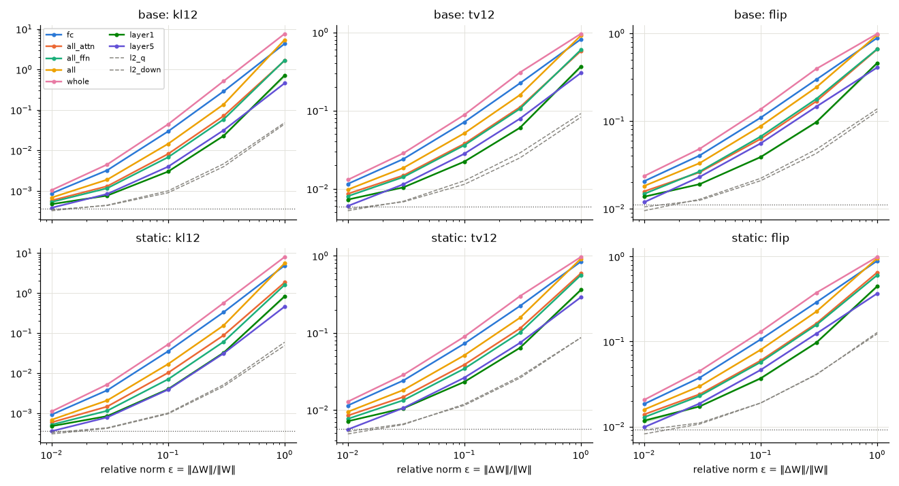
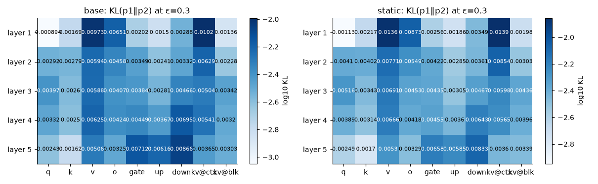
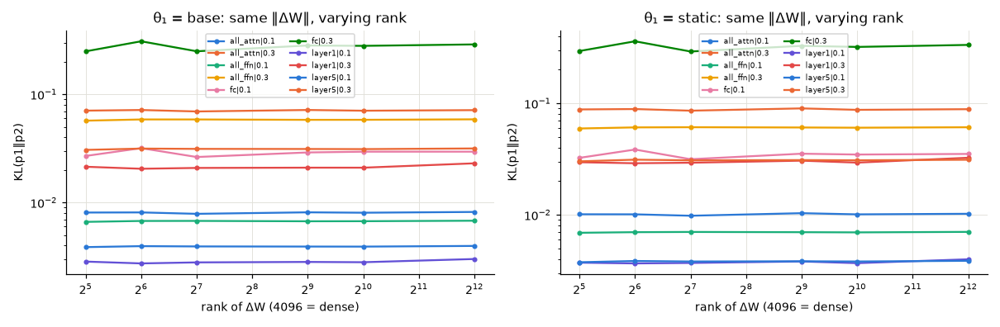
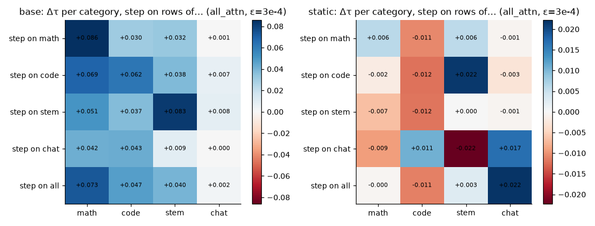
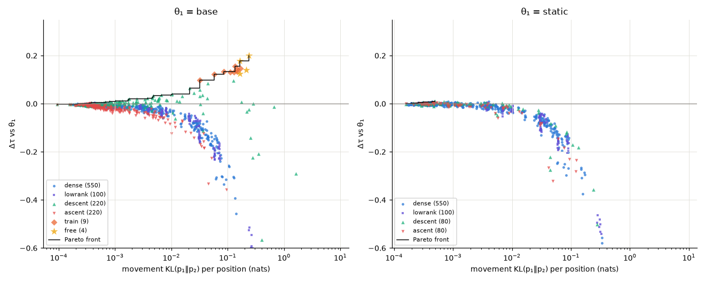
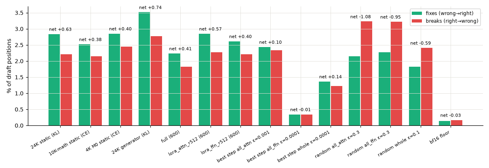
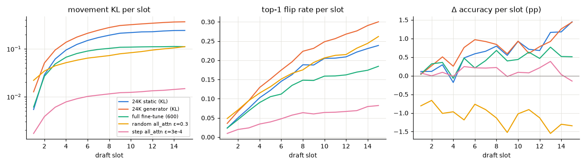
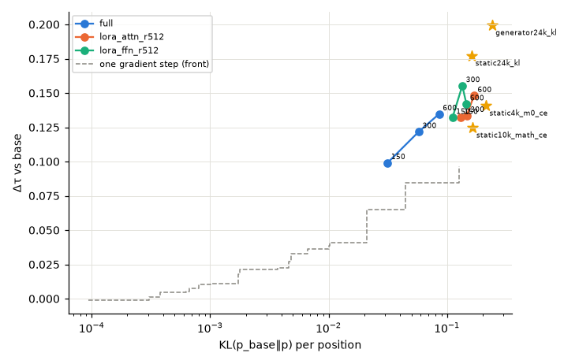

# Move vs Improve: a perturbation study of the DFlash drafter (PERTURB24K)

- **Status:** done (2026-11-11). Plan: `/workspace/yusuf/runs/plans/move_vs_improve_plan.html` (user-approved; decisions D1–D8 at their defaults).
- **Question:** every adapter so far changed τ by a few hundredths (best static LoRA ≈ +0.18 τ over base; the 24K generator beats a matched static by +0.022 τ). Is the drafter (`z-lab/Qwen3-8B-DFlash-b16`) hard to **move**, or hard to **improve**?
- **Results page (figures F1–F9, tables, explanations):** https://claude.ai/artifact/PfGkMMia1hyakW7CT74aEw
- **Code:** `scripts/dflash_port/perturbation/` (tests `tests/unit/scripts/test_dflash_perturb24k.py`). **Raw results:** `/workspace/yusuf/runs/dflash/perturb24k/` (`results/results.json` holds every number below; `results/tables.md` is generated from it by `report_tables.py`).

## TL;DR

- **Hard to improve, not hard to move.** Every part of the drafter moves under weight changes, random changes never help, and every improving change found lies on one concave gain-vs-movement front that flattens near +0.2 τ.
- **Movement is easy.** Random dense noise reaches KL(p₁‖p₂) = 0.01 per position at ε = ‖ΔW‖/‖W‖ ≈ 0.05 on the whole drafter and 0.06 on fc; single modules need ε ≈ 0.3–0.95. Only 2 of 55 locations stay below KL 0.01 at ε = 1 (layer 1 q, layer 1 K/V block path). Trained directions move far more per unit of weight: the 24K static changes attention weights by 2.9% and flips 15.8% of draft tokens (KL 0.16).
- **Random changes never help.** Best Δτ over 1,100 random perturbations from base: +0.004 (bf16 floor at ε = 10⁻⁴: KL 3.7·10⁻⁴, 1.1% flips, Δτ −0.004). Cost grows with movement (whole drafter ε = 0.1: −0.14 τ).
- **Gradient directions climb, briefly.** One descent step on all attention gains +0.097 τ at ε = 10⁻³ (KL 0.13), and −0.29 at ε = 3·10⁻³. At all 220 location × size pairs from base, the ascent step costs more than the descent step gains.
- **Gains are a small net of large flows (H2).** The 24K static fixes 2.84% and breaks 2.21% of draft positions (net +0.63 pp, +0.177 τ on these rows). Every trained point breaks ≈ 0.8 positions per fix.
- **Same ceiling for every training (H3).** 600 updates from base, on all 500 validation rows: full fine-tune (1.05 B) τ 7.375, LoRA r512 attention 7.397, LoRA r512 FFN 7.393; the 3-epoch rank-32 static gives 7.403 and base 7.223. Rank does not limit movement either: random rank-32 ΔW moves the outputs as much as dense ΔW of the same norm.
- **Late slots move, early slots count.** The per-slot Fisher trace grows 7.7× from slot 1 to slot 7; random noise (attention, ε = 0.3) flips 4.8% of slot-1 tokens and 26% at slot 15; the 24K static fixes 0.89% at slot 1 and 3.8% at slot 15. But only 19% of base blocks carry a correct run to slot 15 (87% get slot 1).
- **The objective does not track τ.** Every trained point raises its own KL + D-PACE loss on held-out rows (0.421 → 0.432–0.436) and plain KL to the target (1.85 → 1.90–1.95 nats/position) while τ rises.
- **Categories (H4: unclear).** At base the category gradients mostly agree (noise-corrected cosine 0.71–0.87 on attention); a category's own step beats the shared step by ≈ +0.02 τ, the size of the generator's margin. From the static point the remaining gradient is 4.5× smaller and no category-specific gain is measurable.

## Setup

| | |
|---|---|
| Drafter | `z-lab/Qwen3-8B-DFlash-b16@9b41424b` (target Qwen3-8B): `fc` (20,480 → 4,096) and 5 decoder layers (q/k/v/o, gate/up/down); 1.05 B linear weights. In attention, k_proj/v_proj project both the injected target features (**context path**) and the draft block (**block path**). |
| Starting points θ₁ (D1) | **base** drafter; **static** = base + the 24K static LoRA (KL, rank 32, q/k/v/o of all layers, coefficient 2). The LoRA is applied exactly as trained (W + 2·B·A through the adapter path) rather than rounded into bf16 weights. |
| Perturbation | θ₂ = θ₁ + ΔW, with ΔW applied on a separate path (y = Wx + ΔW x) at fc / q / o / gate / up / down and inside K/V per path, so small ΔW are not lost to bf16 rounding of W. With no ΔW active the forward is the production forward. |
| Evaluation rows (D4) | 100 validation rows (25 per category; seeded sample of the 10K-math validation split), validation anchors (seed 0): 9,1xx blocks × 15 draft slots. Never trained on. |
| Gradients / training rows | 24K training rows only (r0002-100k, subsets 00000–00005 of each category); disjoint from the evaluation rows (checked in code). T0: 1,000 rows per category; per-slot Fisher on 50 rows per category. |
| Loss (D3) | KL(p_T‖p) + D-PACE position weights (the 24K recipe's `block_drafter` settings), through the production forward. |
| Check | On all 500 validation rows the harness gives full_acc 0.52653 for base (recorded 0.52653, base-only runtime; per-row τ max |Δ| 0.19, near-tie re-rounding) and 0.53379 for the static (recorded 0.53379, every row identical). The study's own τ / accuracy code equals the upstream metric on every row. |
| Metrics | offline, greedy, teacher-forced; per slot 1–15 and per category; "all" = mean of the 4 categories (pooled within a category). Movement: KL(p₁‖p₂), KL(p₂‖p₁), JS (full and top-100), TV, top-1 flips, top-k overlap, argmax₂ ∈ top-k₁. Gain: Δτ, Δfull_acc, ΔKL(p_T‖p), ΔTV(p_T, p). Churn vs the target's top-1: fixes, breaks, net. Δτ CIs: paired bootstrap over rows, stratified by category (2,000 resamples). |

What ran (GPU 1 only): T0 gradients and Fisher for both θ₁ (4,000 rows each, ≈ 28 / 39 min); T1 dense Gaussian at 55 locations × ε ∈ {0.01, 0.03, 0.1, 0.3, 1} × 2 seeds for both θ₁, plus a floor control at ε = 10⁻⁴ and the rank sweep (5 locations × ranks 32–1024 × ε ∈ {0.1, 0.3} × 2 seeds); T0 gradient steps (descent and ascent, 4 sizes) at all 55 locations from base and 21 group/path locations from static, plus per-category steps; T2 three 600-update trainings (W&B `dflash-perturb24k-{full,lora_attn_r512,lora_ffn_r512}`); the four existing adapters as free points from base.

## Results

All Δτ are vs the starting point θ₁ on the 100 sweep rows unless marked "500 rows". Figures are the static versions of the results page's interactive ones.

### T1 — random noise: everything moves, nothing improves (F1, F2, F6)

- Dose-response (dense Gaussian, 5 ε, 2 seeds): the seeds agree closely. KL, TV and flips rise smoothly with ε at every location; Δτ only falls.
- Most movable: the whole drafter and fc (KL 0.01 at ε 0.046 / 0.056), then all / all-attention / all-FFN (0.08 / 0.11 / 0.12), single layers (0.16–0.19). Single modules: ε 0.30–0.95. Within attention V, O and the K/V context path move most (layer 1 V and context path: KL 0.010 at ε = 0.3); layer 1 q (0.0009) and the layer 1 block path (0.0014) least. FFN sensitivity grows with depth.
- From the static point the map is the same, slightly more sensitive in attention (all attention KL 0.089 vs 0.071 at ε = 0.3). Best random Δτ from static: +0.010 (layer 2, ε = 0.01, CI [+0.001, +0.020]), one of 652 tries, at floor-level KL 4.4·10⁻⁴.
- Fisher predicts random sensitivity: Spearman 0.92 (base) / 0.92 (static) between ½‖W‖²·tr(F)/n and the measured KL at ε = 0.3 over the 55 locations.
- **Floor:** at ε = 10⁻⁴ (whole drafter) KL 3.7·10⁻⁴, flips 1.10% (base; static 0.92%), Δτ −0.004 / −0.003: bf16 re-rounding flips near-tied argmaxes. Effects below this are numerical.

**Tab 3 — rank sweep** (KL(p₁‖p₂) / Δτ at the same ‖ΔW‖; random ΔW = B·A):

| θ₁ | location · ε | r32 | r64 | r128 | r512 | r1024 | dense |
|---|---|---|---|---|---|---|---|
| base | all_attn · ε=0.1 | 0.00807 / −0.040 | 0.00809 / −0.029 | 0.00786 / −0.029 | 0.00811 / −0.033 | 0.00804 / −0.022 | 0.00817 / −0.033 |
| base | all_attn · ε=0.3 | 0.0706 / −0.226 | 0.0716 / −0.210 | 0.0694 / −0.192 | 0.0716 / −0.191 | 0.0705 / −0.180 | 0.0714 / −0.220 |
| base | all_ffn · ε=0.1 | 0.00662 / −0.045 | 0.00675 / −0.048 | 0.00676 / −0.036 | 0.0067 / −0.042 | 0.00671 / −0.039 | 0.00678 / −0.038 |
| base | all_ffn · ε=0.3 | 0.0571 / −0.202 | 0.0586 / −0.232 | 0.0586 / −0.210 | 0.0581 / −0.201 | 0.0581 / −0.203 | 0.0587 / −0.204 |
| base | fc · ε=0.1 | 0.0269 / −0.074 | 0.0318 / −0.081 | 0.0263 / −0.067 | 0.029 / −0.083 | 0.0295 / −0.069 | 0.0295 / −0.095 |
| base | fc · ε=0.3 | 0.249 / −0.557 | 0.309 / −0.737 | 0.25 / −0.536 | 0.283 / −0.644 | 0.281 / −0.616 | 0.289 / −0.685 |
| base | layer1 · ε=0.1 | 0.00284 / −0.021 | 0.00273 / −0.015 | 0.00279 / −0.015 | 0.00282 / −0.013 | 0.0028 / −0.013 | 0.003 / −0.011 |
| base | layer1 · ε=0.3 | 0.0214 / −0.071 | 0.0205 / −0.068 | 0.0209 / −0.065 | 0.021 / −0.061 | 0.021 / −0.052 | 0.023 / −0.070 |
| base | layer5 · ε=0.1 | 0.00387 / −0.028 | 0.00395 / −0.023 | 0.00392 / −0.025 | 0.00391 / −0.040 | 0.00391 / −0.022 | 0.00397 / −0.032 |
| base | layer5 · ε=0.3 | 0.0306 / −0.139 | 0.0315 / −0.152 | 0.0313 / −0.140 | 0.0312 / −0.151 | 0.0312 / −0.120 | 0.0316 / −0.148 |
| static | all_attn · ε=0.1 | 0.0101 / −0.025 | 0.0101 / −0.027 | 0.00981 / −0.028 | 0.0103 / −0.016 | 0.0101 / −0.019 | 0.0102 / −0.033 |
| static | all_attn · ε=0.3 | 0.0881 / −0.195 | 0.0888 / −0.180 | 0.0859 / −0.155 | 0.09 / −0.146 | 0.0874 / −0.148 | 0.0886 / −0.184 |
| static | all_ffn · ε=0.1 | 0.0069 / −0.048 | 0.00699 / −0.025 | 0.00702 / −0.026 | 0.00698 / −0.012 | 0.00696 / −0.026 | 0.00703 / −0.028 |
| static | all_ffn · ε=0.3 | 0.0595 / −0.168 | 0.0608 / −0.191 | 0.061 / −0.160 | 0.0607 / −0.150 | 0.0604 / −0.168 | 0.061 / −0.168 |
| static | fc · ε=0.1 | 0.0324 / −0.062 | 0.0385 / −0.069 | 0.0315 / −0.046 | 0.0353 / −0.063 | 0.0347 / −0.050 | 0.0352 / −0.057 |
| static | fc · ε=0.3 | 0.294 / −0.487 | 0.36 / −0.638 | 0.292 / −0.488 | 0.328 / −0.569 | 0.32 / −0.521 | 0.334 / −0.568 |
| static | layer1 · ε=0.1 | 0.00372 / −0.009 | 0.00367 / −0.016 | 0.0037 / −0.011 | 0.00382 / −0.002 | 0.00369 / −0.009 | 0.00399 / −0.016 |
| static | layer1 · ε=0.3 | 0.0296 / −0.059 | 0.029 / −0.057 | 0.0293 / −0.063 | 0.0306 / −0.049 | 0.0294 / −0.049 | 0.0325 / −0.073 |
| static | layer5 · ε=0.1 | 0.00376 / −0.023 | 0.00385 / −0.007 | 0.00381 / −0.018 | 0.00383 / −0.010 | 0.00381 / −0.011 | 0.00387 / −0.023 |
| static | layer5 · ε=0.3 | 0.0302 / −0.108 | 0.0312 / −0.114 | 0.0308 / −0.104 | 0.031 / −0.103 | 0.0308 / −0.098 | 0.0312 / −0.119 |

Rank does not change movement: from rank 32 to dense, KL agrees within 4% on all attention, all FFN and layer 5, within 11% on layer 1 and within 15% on fc (no trend with rank), from both starting points.

### T0 — gradients: Fisher, one step, categories (Tab 1, F8)

- Mean training loss (KL + D-PACE) on the 4,000 gradient rows: base math 0.346 / code 0.391 / stem 0.418 / chat 0.503; static 0.350 / 0.403 / 0.434 / 0.521 (higher, see "objective" below).
- One step along the mean gradient: the first grid (ε 3·10⁻³–0.1) destroyed fc and every group already at 3·10⁻³ (KL > 1) and was stopped after 20 rows (file kept aside, unused); the final grid is ε ∈ {10⁻⁴, 3·10⁻⁴, 10⁻³, 3·10⁻³}. The useful step is about 100× smaller than the noise that moves the drafter by the same KL.
- From base, best single steps: all attention +0.097 (ε 10⁻³), all +0.084 (3·10⁻⁴), layer 2 +0.065, layer 3 +0.059, whole +0.046 (10⁻⁴), fc +0.037; all-FFN steps never gain (best −0.006). First-order gain ‖g‖‖W‖ predicts the best step only loosely (Spearman 0.51).
- From the static point: mean gradient 4.5× smaller on attention (‖g‖ 0.0091 vs 0.0413), 5.9× on fc; best step +0.011 (layer 4 context path), within noise; group steps only hurt.

**Tab 1 — per location, θ₁ = base** (Fisher trace = mean squared per-row gradient norm; ε thresholds interpolated on the seed-mean dose-response; "flips floor+1pp" = ε where flips exceed the floor by 1 point; ‖g‖·‖W‖ = first-order loss change per unit ε):

| Location | Fisher trace | ½‖W‖²·tr(F)/n | ε: KL=0.01 | ε: flips floor+1pp | KL @ ε=0.3 | ‖g‖·‖W‖ | Δτ step 3e-4 (desc / asc) | best step Δτ (ε) |
|---|---|---|---|---|---|---|---|---|
| fc | 0.296 | 0.00537 | 0.056 | 0.01 | 0.289 | 115 | +0.037 / −0.185 | +0.037 (0.0003) |
| l0_q | 0.00227 | 1.6e-05 | > 1 | 0.39 | 8.9e-04 | 0.477 | −0.005 / −0.007 | −0.002 (0.001) |
| l0_k | 0.00491 | 3.7e-05 | 0.76 | 0.17 | 0.00169 | 0.582 | −0.007 / −0.003 | +0.002 (0.001) |
| l0_v | 0.0595 | 2.4e-04 | 0.3 | 0.052 | 0.00973 | 2.87 | −0.001 / −0.013 | +0.021 (0.003) |
| l0_o | 0.0324 | 1.6e-04 | 0.37 | 0.066 | 0.00651 | 2.49 | −0.003 / −0.016 | +0.021 (0.003) |
| l0_gate | 0.00689 | 4.6e-05 | 0.73 | 0.14 | 0.00202 | 1.33 | −0.003 / −0.004 | +0.005 (0.003) |
| l0_up | 0.00394 | 2.9e-05 | 0.95 | 0.17 | 0.0015 | 1.19 | −0.006 / −0.004 | +0.004 (0.003) |
| l0_down | 0.00906 | 6.6e-05 | 0.58 | 0.11 | 0.00288 | 1.81 | −0.009 / −0.005 | +0.008 (0.003) |
| l1_q | 0.00723 | 5.6e-05 | 0.58 | 0.12 | 0.00292 | 1.65 | −0.004 / −0.013 | +0.006 (0.001) |
| l1_k | 0.00712 | 5.1e-05 | 0.6 | 0.12 | 0.00279 | 0.701 | −0.005 / −0.006 | −0.004 (0.003) |
| l1_v | 0.0254 | 1.4e-04 | 0.39 | 0.072 | 0.00594 | 2.77 | −0.011 / −0.012 | +0.022 (0.003) |
| l1_o | 0.0156 | 1.0e-04 | 0.45 | 0.088 | 0.00458 | 1.7 | −0.001 / −0.003 | +0.010 (0.003) |
| l1_gate | 0.0116 | 7.9e-05 | 0.52 | 0.11 | 0.00349 | 2.37 | −0.000 / −0.010 | +0.011 (0.003) |
| l1_up | 0.0065 | 5.0e-05 | 0.67 | 0.13 | 0.00241 | 2.47 | −0.001 / −0.007 | +0.018 (0.003) |
| l1_down | 0.00867 | 6.5e-05 | 0.54 | 0.11 | 0.00332 | 2.22 | −0.007 / −0.007 | +0.006 (0.003) |
| l2_q | 0.00992 | 7.9e-05 | 0.47 | 0.1 | 0.00397 | 3.85 | +0.002 / −0.018 | +0.038 (0.003) |
| l2_k | 0.00719 | 5.2e-05 | 0.6 | 0.13 | 0.0026 | 1.66 | −0.009 / −0.007 | −0.003 (0.003) |
| l2_v | 0.0152 | 1.1e-04 | 0.39 | 0.074 | 0.00588 | 3.72 | +0.002 / −0.017 | +0.015 (0.003) |
| l2_o | 0.00937 | 7.0e-05 | 0.48 | 0.099 | 0.00407 | 1.84 | +0.001 / −0.006 | +0.002 (0.003) |
| l2_gate | 0.0106 | 7.2e-05 | 0.49 | 0.1 | 0.00384 | 2.68 | −0.003 / −0.006 | +0.003 (0.003) |
| l2_up | 0.00653 | 5.1e-05 | 0.6 | 0.12 | 0.00281 | 3.56 | +0.005 / −0.014 | +0.009 (0.003) |
| l2_down | 0.00922 | 7.1e-05 | 0.44 | 0.089 | 0.00466 | 2.59 | −0.001 / −0.002 | +0.004 (0.003) |
| l3_q | 0.00581 | 4.6e-05 | 0.53 | 0.11 | 0.00332 | 3.74 | −0.001 / −0.012 | +0.015 (0.003) |
| l3_k | 0.00527 | 3.9e-05 | 0.63 | 0.13 | 0.0025 | 2.83 | −0.001 / −0.008 | −0.001 (0.0003) |
| l3_v | 0.00605 | 8.0e-05 | 0.38 | 0.071 | 0.00625 | 4.68 | −0.005 / −0.017 | +0.026 (0.003) |
| l3_o | 0.00464 | 4.7e-05 | 0.47 | 0.1 | 0.00424 | 1.72 | −0.003 / −0.008 | +0.000 (0.001) |
| l3_gate | 0.0093 | 6.3e-05 | 0.45 | 0.092 | 0.00449 | 2.7 | −0.004 / −0.007 | +0.003 (0.003) |
| l3_up | 0.00642 | 5.0e-05 | 0.51 | 0.11 | 0.00367 | 3.68 | −0.009 / −0.014 | +0.005 (0.003) |
| l3_down | 0.00941 | 7.2e-05 | 0.36 | 0.076 | 0.00695 | 2.97 | −0.005 / −0.006 | +0.006 (0.003) |
| l4_q | 0.00373 | 2.9e-05 | 0.63 | 0.14 | 0.00243 | 3.69 | −0.006 / −0.014 | −0.004 (0.0001) |
| l4_k | 0.00341 | 2.5e-05 | 0.81 | 0.18 | 0.00162 | 3.56 | −0.005 / −0.011 | −0.005 (0.0003) |
| l4_v | 0.00337 | 5.2e-05 | 0.43 | 0.08 | 0.00506 | 5.44 | −0.000 / −0.017 | +0.015 (0.003) |
| l4_o | 0.00238 | 2.6e-05 | 0.55 | 0.12 | 0.00325 | 1.77 | −0.003 / −0.008 | +0.000 (0.003) |
| l4_gate | 0.0108 | 7.2e-05 | 0.36 | 0.055 | 0.00712 | 3.84 | −0.010 / −0.006 | −0.001 (0.0001) |
| l4_up | 0.00976 | 7.3e-05 | 0.39 | 0.062 | 0.00616 | 4.48 | −0.010 / −0.019 | −0.006 (0.0001) |
| l4_down | 0.0121 | 8.7e-05 | 0.32 | 0.054 | 0.00866 | 3.85 | −0.004 / −0.005 | −0.003 (0.0001) |
| l0_kv@ctx | 0.0602 | 3.5e-04 | 0.3 | 0.052 | 0.0102 | 4.82 | +0.002 / −0.026 | +0.031 (0.003) |
| l0_kv@blk | 0.00502 | 2.9e-05 | > 1 | 0.19 | 0.00136 | 1.18 | −0.013 / −0.006 | −0.000 (0.003) |
| l1_kv@ctx | 0.0264 | 1.7e-04 | 0.38 | 0.072 | 0.00629 | 3.84 | +0.003 / −0.018 | +0.036 (0.003) |
| l1_kv@blk | 0.006 | 3.8e-05 | 0.7 | 0.13 | 0.00228 | 1.78 | −0.005 / −0.011 | +0.008 (0.003) |
| l2_kv@ctx | 0.0147 | 1.1e-04 | 0.43 | 0.084 | 0.00504 | 4.18 | −0.005 / −0.018 | +0.017 (0.003) |
| l2_kv@blk | 0.00763 | 5.6e-05 | 0.53 | 0.1 | 0.00342 | 3.9 | −0.005 / −0.022 | +0.016 (0.003) |
| l3_kv@ctx | 0.00684 | 7.1e-05 | 0.41 | 0.083 | 0.00541 | 4.23 | −0.009 / −0.012 | +0.012 (0.003) |
| l3_kv@blk | 0.00446 | 4.6e-05 | 0.57 | 0.11 | 0.0032 | 6.19 | −0.005 / −0.018 | +0.012 (0.003) |
| l4_kv@ctx | 0.00387 | 4.4e-05 | 0.52 | 0.11 | 0.00365 | 4.35 | −0.003 / −0.006 | −0.000 (0.003) |
| l4_kv@blk | 0.00289 | 3.3e-05 | 0.57 | 0.1 | 0.00303 | 7.99 | −0.002 / −0.017 | +0.009 (0.003) |
| all_attn | 0.231 | 0.00183 | 0.11 | 0.019 | 0.0714 | 75.3 | +0.041 / −0.083 | +0.097 (0.001) |
| all_ffn | 0.131 | 9.5e-04 | 0.12 | 0.019 | 0.0587 | 43.9 | −0.009 / −0.049 | −0.006 (0.0001) |
| all | 0.362 | 0.00268 | 0.08 | 0.013 | 0.137 | 164 | +0.084 / −0.184 | +0.084 (0.0003) |
| layer1 | 0.119 | 8.1e-04 | 0.19 | 0.036 | 0.023 | 28 | +0.022 / −0.053 | +0.023 (0.001) |
| layer2 | 0.0822 | 6.0e-04 | 0.19 | 0.036 | 0.0225 | 24.7 | +0.020 / −0.038 | +0.065 (0.001) |
| layer3 | 0.068 | 5.1e-04 | 0.18 | 0.036 | 0.0251 | 32.6 | +0.017 / −0.059 | +0.059 (0.001) |
| layer4 | 0.0469 | 3.7e-04 | 0.17 | 0.035 | 0.0294 | 35.9 | +0.004 / −0.042 | +0.032 (0.001) |
| layer5 | 0.0456 | 3.5e-04 | 0.16 | 0.026 | 0.0316 | 41.1 | +0.004 / −0.036 | +0.004 (0.0003) |
| whole | 0.658 | 0.00543 | 0.046 | 0.01 | 0.517 | 329 | −0.025 / −0.724 | +0.046 (0.0001) |

**Tab 1 — θ₁ = 24K static** (gradient steps only at fc, K/V paths, groups and layers):

| Location | Fisher trace | ½‖W‖²·tr(F)/n | ε: KL=0.01 | ε: flips floor+1pp | KL @ ε=0.3 | ‖g‖·‖W‖ | Δτ step 3e-4 (desc / asc) | best step Δτ (ε) |
|---|---|---|---|---|---|---|---|---|
| fc | 0.364 | 0.0066 | 0.051 | 0.011 | 0.334 | 19.5 | −0.038 / −0.081 | −0.012 (0.0001) |
| l0_q | 0.00345 | 2.5e-05 | > 1 | 0.36 | 0.00113 | – | – | – |
| l0_k | 0.007 | 5.3e-05 | 0.63 | 0.17 | 0.00217 | – | – | – |
| l0_v | 0.0772 | 3.1e-04 | 0.25 | 0.051 | 0.0136 | – | – | – |
| l0_o | 0.0411 | 2.1e-04 | 0.32 | 0.068 | 0.00873 | – | – | – |
| l0_gate | 0.00815 | 5.4e-05 | 0.62 | 0.14 | 0.00256 | – | – | – |
| l0_up | 0.00488 | 3.5e-05 | 0.78 | 0.18 | 0.00186 | – | – | – |
| l0_down | 0.0108 | 7.8e-05 | 0.52 | 0.12 | 0.00349 | – | – | – |
| l1_q | 0.0101 | 7.9e-05 | 0.48 | 0.12 | 0.0041 | – | – | – |
| l1_k | 0.00996 | 7.1e-05 | 0.49 | 0.12 | 0.00402 | – | – | – |
| l1_v | 0.0321 | 1.8e-04 | 0.34 | 0.072 | 0.00771 | – | – | – |
| l1_o | 0.019 | 1.2e-04 | 0.41 | 0.087 | 0.00549 | – | – | – |
| l1_gate | 0.0139 | 9.4e-05 | 0.46 | 0.1 | 0.00422 | – | – | – |
| l1_up | 0.00777 | 6.0e-05 | 0.6 | 0.13 | 0.00285 | – | – | – |
| l1_down | 0.00996 | 7.5e-05 | 0.51 | 0.11 | 0.00361 | – | – | – |
| l2_q | 0.0133 | 1.1e-04 | 0.42 | 0.1 | 0.00516 | – | – | – |
| l2_k | 0.00959 | 7.0e-05 | 0.51 | 0.12 | 0.00343 | – | – | – |
| l2_v | 0.0178 | 1.3e-04 | 0.36 | 0.075 | 0.00691 | – | – | – |
| l2_o | 0.0108 | 8.1e-05 | 0.45 | 0.1 | 0.00453 | – | – | – |
| l2_gate | 0.0122 | 8.3e-05 | 0.45 | 0.1 | 0.00435 | – | – | – |
| l2_up | 0.0074 | 5.7e-05 | 0.57 | 0.13 | 0.00305 | – | – | – |
| l2_down | 0.0102 | 7.8e-05 | 0.44 | 0.1 | 0.00467 | – | – | – |
| l3_q | 0.00693 | 5.5e-05 | 0.49 | 0.11 | 0.00389 | – | – | – |
| l3_k | 0.00633 | 4.7e-05 | 0.55 | 0.13 | 0.00314 | – | – | – |
| l3_v | 0.00651 | 8.7e-05 | 0.37 | 0.079 | 0.00666 | – | – | – |
| l3_o | 0.00495 | 5.0e-05 | 0.47 | 0.1 | 0.00418 | – | – | – |
| l3_gate | 0.0101 | 6.9e-05 | 0.44 | 0.1 | 0.00455 | – | – | – |
| l3_up | 0.00666 | 5.2e-05 | 0.52 | 0.11 | 0.0036 | – | – | – |
| l3_down | 0.0101 | 7.8e-05 | 0.37 | 0.086 | 0.00643 | – | – | – |
| l4_q | 0.00413 | 3.2e-05 | 0.62 | 0.15 | 0.00249 | – | – | – |
| l4_k | 0.00359 | 2.6e-05 | 0.77 | 0.19 | 0.0017 | – | – | – |
| l4_v | 0.00329 | 5.1e-05 | 0.42 | 0.088 | 0.0053 | – | – | – |
| l4_o | 0.00256 | 2.8e-05 | 0.54 | 0.13 | 0.00329 | – | – | – |
| l4_gate | 0.0115 | 7.7e-05 | 0.37 | 0.067 | 0.00658 | – | – | – |
| l4_up | 0.00956 | 7.1e-05 | 0.4 | 0.071 | 0.00585 | – | – | – |
| l4_down | 0.0137 | 9.8e-05 | 0.33 | 0.062 | 0.00833 | – | – | – |
| l0_kv@ctx | 0.0781 | 4.5e-04 | 0.25 | 0.05 | 0.0139 | 1.48 | +0.003 / +0.005 | +0.003 (0.0003) |
| l0_kv@blk | 0.00727 | 4.2e-05 | 0.76 | 0.17 | 0.00198 | 0.445 | −0.003 / +0.004 | +0.005 (0.001) |
| l1_kv@ctx | 0.0336 | 2.1e-04 | 0.33 | 0.074 | 0.00854 | 1.01 | +0.001 / −0.003 | +0.004 (0.003) |
| l1_kv@blk | 0.00833 | 5.3e-05 | 0.57 | 0.13 | 0.00303 | 0.498 | −0.001 / −0.005 | +0.004 (0.001) |
| l2_kv@ctx | 0.0181 | 1.3e-04 | 0.39 | 0.086 | 0.00598 | 0.805 | +0.001 / −0.003 | +0.001 (0.0003) |
| l2_kv@blk | 0.0093 | 6.9e-05 | 0.46 | 0.098 | 0.00436 | 0.623 | +0.002 / −0.001 | +0.002 (0.0003) |
| l3_kv@ctx | 0.00763 | 7.9e-05 | 0.4 | 0.088 | 0.00565 | 0.609 | +0.007 / −0.004 | +0.011 (0.001) |
| l3_kv@blk | 0.00519 | 5.4e-05 | 0.49 | 0.11 | 0.00396 | 0.543 | −0.000 / +0.004 | −0.000 (0.0003) |
| l4_kv@ctx | 0.00421 | 4.8e-05 | 0.52 | 0.12 | 0.0036 | 0.487 | +0.002 / +0.002 | +0.002 (0.0003) |
| l4_kv@blk | 0.00265 | 3.0e-05 | 0.53 | 0.11 | 0.00339 | 0.395 | +0.003 / +0.000 | +0.004 (0.003) |
| all_attn | 0.29 | 0.0023 | 0.099 | 0.019 | 0.0886 | 16.5 | +0.003 / −0.011 | +0.009 (0.0001) |
| all_ffn | 0.147 | 0.00107 | 0.12 | 0.021 | 0.061 | 21.1 | −0.008 / −0.007 | +0.003 (0.0001) |
| all | 0.437 | 0.00323 | 0.074 | 0.014 | 0.156 | 41.9 | −0.007 / −0.017 | +0.003 (0.0001) |
| layer1 | 0.153 | 0.00104 | 0.16 | 0.035 | 0.0325 | 10.6 | −0.000 / −0.013 | −0.000 (0.0001) |
| layer2 | 0.103 | 7.5e-04 | 0.17 | 0.037 | 0.0297 | 8.83 | +0.001 / −0.003 | +0.003 (0.0001) |
| layer3 | 0.0814 | 6.1e-04 | 0.17 | 0.036 | 0.0297 | 8.16 | +0.003 / −0.007 | +0.005 (0.0001) |
| layer4 | 0.0516 | 4.0e-04 | 0.17 | 0.037 | 0.0306 | 6.56 | +0.006 / −0.001 | +0.006 (0.0003) |
| layer5 | 0.0484 | 3.7e-04 | 0.16 | 0.031 | 0.0312 | 6.64 | −0.007 / −0.004 | +0.003 (0.0001) |
| whole | 0.801 | 0.00662 | 0.042 | 0.01 | 0.567 | 65.6 | −0.170 / −0.281 | −0.022 (0.0001) |

**Tab 4 — category view** (per-category descent steps at ε = 3·10⁻⁴; Δτ on the evaluated category's 25 rows, averaged over categories; cosines between the categories' mean gradients, raw and divided by the ceiling that gradient noise alone allows, from the per-row Fisher):

| θ₁ | location | Δτ own-category step | Δτ other-category steps | Δτ shared step |
|---|---|---|---|---|
| base | fc | +0.035 | +0.016 | +0.037 |
| base | all_attn | +0.058 | +0.031 | +0.041 |
| base | all_ffn | +0.003 | −0.011 | −0.009 |
| base | all | +0.091 | +0.054 | +0.084 |
| base | whole | −0.039 | −0.035 | −0.025 |
| base | layer1 | +0.025 | +0.009 | +0.022 |
| base | layer2 | +0.023 | +0.009 | +0.020 |
| base | layer3 | +0.027 | +0.013 | +0.017 |
| base | layer4 | +0.015 | +0.009 | +0.004 |
| base | layer5 | +0.006 | −0.003 | +0.004 |
| static | fc | −0.044 | −0.030 | −0.038 |
| static | all_attn | +0.003 | −0.002 | +0.003 |
| static | all_ffn | −0.003 | −0.004 | −0.008 |
| static | all | −0.003 | −0.009 | −0.007 |
| static | whole | −0.144 | −0.108 | −0.170 |
| static | layer1 | −0.010 | −0.003 | −0.000 |
| static | layer2 | +0.002 | +0.003 | +0.001 |
| static | layer3 | +0.005 | +0.000 | +0.003 |
| static | layer4 | +0.008 | +0.001 | +0.006 |
| static | layer5 | −0.001 | −0.003 | −0.007 |

Gradient cosines and KL-to-target changes (×10⁻³; negative = KL rose):

| θ₁ | location | mean gradient cosine (raw / ÷ noise ceiling) | own-category step | other-category steps | shared step |
|---|---|---|---|---|---|
| base | fc | 0.676 / 0.72 | -34.701 | -25.707 | -31.426 |
| base | all_attn | 0.688 / 0.79 | -10.162 | -8.258 | -11.148 |
| base | all_ffn | 0.337 / 0.57 | -4.354 | -2.382 | -4.656 |
| base | all | 0.672 / 0.81 | -42.977 | -30.072 | -43.932 |
| base | whole | 0.677 / 0.75 | -237.892 | -154.379 | -206.938 |
| base | layer1 | 0.507 / 0.70 | +2.009 | +1.778 | +2.306 |
| base | layer2 | 0.489 / 0.66 | +0.357 | -0.203 | -0.249 |
| base | layer3 | 0.636 / 0.75 | -2.950 | -2.656 | -3.527 |
| base | layer4 | 0.748 / 0.85 | -5.829 | -5.163 | -6.416 |
| base | layer5 | 0.756 / 0.85 | -7.213 | -5.881 | -7.274 |
| static | fc | 0.037 / 0.19 | -9.026 | -8.628 | -11.134 |
| static | all_attn | 0.013 / 0.15 | -1.362 | -2.445 | -3.948 |
| static | all_ffn | 0.010 / 0.13 | -0.782 | -0.437 | -1.034 |
| static | all | 0.014 / 0.16 | -4.357 | -5.552 | -9.015 |
| static | whole | 0.027 / 0.19 | -46.885 | -38.283 | -59.601 |
| static | layer1 | 0.009 / 0.11 | -0.377 | -1.526 | -2.046 |
| static | layer2 | 0.008 / 0.13 | +0.090 | -0.398 | -0.577 |
| static | layer3 | 0.016 / 0.19 | -0.788 | -0.647 | -1.403 |
| static | layer4 | 0.014 / 0.18 | -0.044 | -0.233 | -0.342 |
| static | layer5 | 0.019 / 0.13 | -1.291 | -1.109 | -2.313 |

- From base the categories agree: on all attention the pairwise cosines are 0.58–0.82 raw, 0.71–0.87 noise-corrected. A step on a category's own gradient still helps it more: +0.058 τ own vs +0.031 from other categories' steps vs +0.041 shared. The per-category first-order margin (≈ +0.02 τ) matches the generator's measured margin over the static (+0.022, MIX24K).
- From the static point the noise ceiling for a category pair falls to 0.08–0.10: 1,000 rows per category no longer resolve the remaining gradient's direction, and category steps gain nothing measurable.

### Movement vs gain, churn and slots (F3, F4, F5)

- **Pareto front from base** (best Δτ at ≤ movement): one step on attention +0.041 at KL 0.010; layer 2 step +0.065 at 0.021; full fine-tune +0.099 / +0.122 / +0.135 at KL 0.032 / 0.058 / 0.086 (150 / 300 / 600 updates); FFN LoRA (300) +0.155 at 0.135; 24K static +0.177 at 0.162; 24K generator +0.199 at 0.239. Above the floor, every front point is a gradient step, a training checkpoint or a trained adapter; no random perturbation is.
- **From static** the front only reaches +0.011 (KL 4.9·10⁻⁴).

- Churn: see Tab 2; trained points break 0.78–0.89 positions per fix; random noise at similar KL breaks more than it fixes (all attention ε = 0.3: 2.15% fixed, 3.23% broken).
- Per slot: movement and churn rise with slot (Fisher ×7.7 from slot 1 to 7); the static's gain per slot is spread over slots 3–15, where few blocks still have a correct run.

### T2 — short trainings (F7, Tab 2)

**Tab 2 — trained points, measured from base** (100 rows; rel. ‖ΔW‖ over the trained weights; the existing adapters differ in data and loss and are reference points):

| Run | update | rel. ‖ΔW‖ | KL(p_base‖p) | TV | flips | Δτ [95% CI] | Δ full_acc | Δ KL(p_T‖p) | fixes | breaks | net |
|---|---|---|---|---|---|---|---|---|---|---|---|
| full fine-tune (1.05B) | 150 | 0.00109 | 0.0315 | 0.0649 | 8.0% | +0.099 [+0.070, +0.129] | +0.0028 | +0.025 | 1.48% | 1.20% | +0.28 pp |
| full fine-tune (1.05B) | 300 | 0.00161 | 0.0577 | 0.0857 | 10.6% | +0.122 [+0.087, +0.157] | +0.0035 | +0.040 | 1.93% | 1.57% | +0.35 pp |
| full fine-tune (1.05B) | 600 | 0.0023 | 0.0858 | 0.102 | 12.5% | +0.135 [+0.096, +0.174] | +0.0041 | +0.055 | 2.23% | 1.83% | +0.41 pp |
| LoRA r512 attention (67M) | 150 | 0.0141 | 0.129 | 0.121 | 14.5% | +0.132 [+0.092, +0.171] | +0.0037 | +0.100 | 2.49% | 2.12% | +0.37 pp |
| LoRA r512 attention (67M) | 300 | 0.0228 | 0.147 | 0.128 | 15.5% | +0.134 [+0.095, +0.173] | +0.0045 | +0.102 | 2.67% | 2.22% | +0.45 pp |
| LoRA r512 attention (67M) | 600 | 0.0339 | 0.169 | 0.134 | 16.1% | +0.148 [+0.107, +0.188] | +0.0057 | +0.110 | 2.85% | 2.28% | +0.57 pp |
| LoRA r512 FFN (126M) | 150 | 0.0169 | 0.111 | 0.113 | 13.6% | +0.132 [+0.094, +0.171] | +0.0025 | +0.090 | 2.34% | 2.09% | +0.25 pp |
| LoRA r512 FFN (126M) | 300 | 0.0255 | 0.135 | 0.122 | 14.7% | +0.155 [+0.120, +0.192] | +0.0040 | +0.101 | 2.56% | 2.17% | +0.40 pp |
| LoRA r512 FFN (126M) | 600 | 0.0365 | 0.146 | 0.126 | 15.1% | +0.142 [+0.104, +0.180] | +0.0040 | +0.102 | 2.61% | 2.21% | +0.40 pp |
| 24K static (KL, r32 attn, 4,000 upd.) | final | 0.0293 | 0.162 | 0.132 | 15.8% | +0.177 [+0.134, +0.217] | +0.0063 | +0.102 | 2.84% | 2.21% | +0.63 pp |
| 10K-math static (CE) | final | 0.0291 | 0.165 | 0.134 | 13.8% | +0.125 [+0.087, +0.164] | +0.0038 | +0.128 | 2.52% | 2.15% | +0.38 pp |
| 4K M0 static (CE) | final | 0.0299 | 0.213 | 0.154 | 16.0% | +0.141 [+0.097, +0.183] | +0.0040 | +0.169 | 2.85% | 2.45% | +0.40 pp |
| 24K generator (KL) | final | per row | 0.239 | 0.16 | 19.6% | +0.199 [+0.152, +0.244] | +0.0074 | +0.135 | 3.52% | 2.78% | +0.74 pp |

**500 validation rows** (category mean):

| Model (500 validation rows) | full_acc | τ |
|---|---|---|
| base (this harness) | 0.5265 | 7.223 |
| 24K static (this harness) | 0.5338 | 7.403 |
| full fine-tune (1.05B), 600 updates | 0.5326 | 7.375 |
| LoRA r512 attention (67M), 600 updates | 0.5336 | 7.397 |
| LoRA r512 FFN (126M), 600 updates | 0.5328 | 7.393 |

- The rank-512 LoRAs reach ≈ +0.13 τ within 150 updates and then gain little; the full fine-tune (LR 10⁻⁵) moves less (KL 0.086 at 600 updates, ‖ΔW‖/‖W‖ 0.0023) and gains +0.135. None exceeds the 3-epoch rank-32 static on 500 rows.
- **Objective vs τ** (`results/loss_check.json`, 100 sweep rows): training loss (KL + D-PACE) base 0.421, static 0.434, full 0.432, LoRA attention 0.436, LoRA FFN 0.435; plain KL(p_T‖p) per position 1.85 → 1.90–1.95; τ (pooled) 7.59 → 7.73–7.79. Logged training loss is flat over T2 (mean of updates ≤ 100 vs > 500: full 0.408 → 0.411, attention 0.413 → 0.415, FFN 0.412 → 0.416) and rose in the 24K static run (0.418 in its first 100 updates, 0.431 near update 3,600; its `timing.json`). Upstream documents the D-PACE weights for a cross-entropy per-position loss; here they are computed from KL. Whether that explains the mismatch is open.

## Hypotheses (Tab 5)

| | Hypothesis | Verdict | Evidence |
|---|---|---|---|
| H1 | Some locations are nearly flat; adapters there are wasted. | **not supported** | 2 of 55 locations stay below KL 0.01 at ε = 1 (layer 1 q, layer 1 K/V block path); all others move (groups at ε 0.05–0.19). Flatness to noise does not mean uselessness: FFN steps gain nothing at first order, yet a rank-512 FFN LoRA trains to the attention LoRA's τ (7.393 vs 7.397, 500 rows). |
| H2 | Easy to move, hard to improve: flips, fixes and breaks nearly cancel. | **supported** | 24K static: 15.8% flips from a 2.9% weight change, 2.84% fixed vs 2.21% broken; trained points break ≈ 0.8 per fix; no random perturbation beats the floor (best +0.004 of 1,100 from base). |
| H3 | Gain reaches a ceiling at small movement; full fine-tuning raises it little. | **supported** (one seed, one LR, 600 updates) | Front flattens (+0.04 at KL 0.01, +0.10 at 0.03, +0.18 at 0.16, +0.20 at 0.24); 500 rows: full 7.375, LoRA r512 attention 7.397 / FFN 7.393, static r32 7.403. |
| H4 | Where category gradients disagree, a per-prompt adapter has room. | **unclear** | Base: categories agree (corrected cosine 0.71–0.87), per-category step margin ≈ +0.02 τ (≈ the generator's +0.022). Static: residual gradient 4.5× smaller, not resolvable per category; category steps gain nothing measurable. |

## Interpretation

- The drafter is not stiff: small, well-aimed weight changes move many draft tokens. What is scarce is improvement: almost every direction is harmful, the useful directions are narrow (a step 3× too large reverses the gain), and the useful moves fix and break tokens at nearly the same rate.
- The ceiling does not come from adapter capacity: full fine-tuning, rank 512, FFN placement and rank-32 attention land at the same τ, and rank does not limit how far ΔW moves the outputs.
- The gain that remains after a static adapter is small at first order. From base, a per-category direction is worth ≈ +0.02 τ over a shared one, consistent with the generator's measured margin, so a generator on this data can be expected to add about that much.
- The training objective rises on held-out rows while τ rises. τ improvements therefore do not come from matching the target distribution better in KL; this is the most direct lead for changing what is optimized.

## Implications for adapter / generator design (future_suggestions.md)

1. **D3 τ-aligned loss / D-PACE from CE confidences first.** Three 600-update runs (≈ 1 h each on one GPU) are enough to see whether loss and τ then move together.
2. **Early-slot weighting or early-slot capacity.** Slots 1–4 decide most of τ but move least.
3. **Step control.** LR sweep for full fine-tuning (D5 alternative: 10⁻⁶, 10⁻⁵, 5·10⁻⁵) and a trust-region or line-searched update for static LoRAs.
4. **Generator: small and on top of the static (D1 static + residual, G1 basis-LoRA with LoRA 0 = static, A1 routed per-category statics).** Expect ≈ +0.02 τ, the measured first-order per-category margin; G1–G3 should reach it at a fraction of 1.1 B parameters.
5. **No more capacity** (rank, full fine-tuning, FFN targets) until the objective changes.

## Limits

- One seed per training run; differences between T2 runs (≤ 0.03 τ on 500 rows) are at the size of earlier seed drift.
- Offline, greedy, teacher-forced metrics; no serving or sampled acceptance.
- 100 evaluation rows (Δτ CI ≈ ±0.04; per category 25 rows); T2 end points also on 500 rows.
- Gradient steps from static cover 21 group / path locations (time budget); single q / o / FFN modules only from base.
- The existing adapters (24K KL, 10K-math CE, 4K CE) differ in data and loss; they are reference points.
- Movement is measured from θ₁; per-row LoRAs of the generator are averaged as per-row metrics pooled over rows.

## Artifacts

- Raw: `/workspace/yusuf/runs/dflash/perturb24k/` — `verify/verify.json`, `calibrate/`, `t0/{base,static}/` (mean gradients bf16, per-row and per-slot Fisher, category geometry), `t1/{base,static}_{dense,lowrank}.pt`, `t0steps/{base,static}.pt` (`base_eps_too_large_partial.pt`: stopped first grid), `free/base.pt`, `t2/<run>/` (eval at updates 0/150/300/600, `validation500.json`, `final_delta.pt`, `summary.json`), `results/{results.json,tables.md,loss_check.json,move_vs_improve.html}`, `logs/`.
- W&B (project dyn-spec-dflash-v1): `dflash-perturb24k-full` (vgb7qq8e), `dflash-perturb24k-lora_attn_r512` (zoryxqn1), `dflash-perturb24k-lora_ffn_r512` (sorebozk). Nothing pushed to HF.
- Inputs: static checkpoint `/workspace/yusuf/runs/dflash/mix24k/mix24k-static-lora-attn-r32-3ep-kl/pretraining/.../checkpoint.pt`; generator `…/mix24k-generator-attn-r32-3ep-kl`; store `output/dflash-lora/activation-store-mix24k` (read only).
